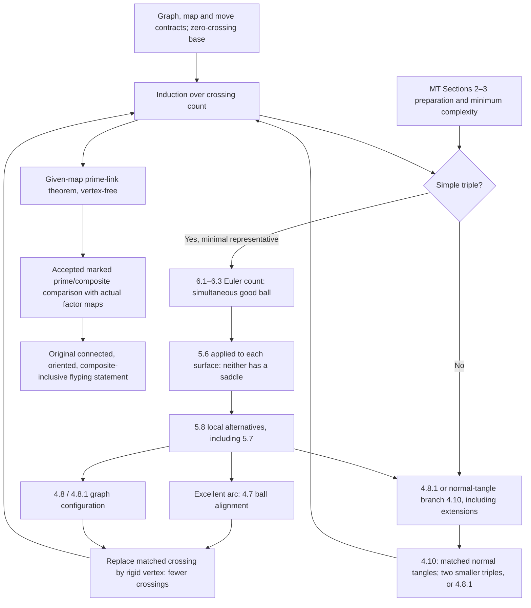

# MT route: execution DAG and source-readiness ledger

2026-10-21. Research plan only. This is the consolidated MT implementation route for the unchanged original105 claim, not a canonical item edit or proof acceptance. New proof-detail authoring remains paused. The complete global architecture is supported by actual primary pages; preparation and local supplier contracts remain to bind. The Kindred parent route stays a blocked alternative and is not a supplier to this DAG.

## Original scope and source-backed DAG

Retain connected reduced alternating diagrams on the oriented sphere of the same oriented link, including composite links. Obtain the actual oriented pair map. The prime engine works in MT's larger category of reduced prime oriented alternating rigid-vertex graphs and retains the GIVEN map. Outer induction counts crossings, allowing arbitrarily many rigid vertices; neither link-only induction nor graph-vertex induction replaces it.

The recursive arrows express an induction, not circular supplier use. 4.10's sphere matching uses external [13]5.1 and 4.9 BEFORE applying the smaller-crossing hypothesis. The counting branch does not assume flyping. Excellent arcs are a local output of alternatives, not an unproved universal existence assertion.

## Readiness by mathematical block

| Block and exact output | Primary support actually read | Still required before local implementation can be treated as complete |
| --- | --- | --- |
| **G: graph/map/move and induction contracts** | MT pp116–119 main theorem, rigid-graph enlargement and base; pp137–138 P(T), crossing induction and4.1 | Complete graph-flype/nullification and pair-isotopy conventions; cited base [4]Lemma1 or an actual replacement proof at that exact scope; diagrammatic prime/reduced inheritance and collapse/expansion transfer |
| **E: finite four-surface preparation and minimum** | Roadmap p119, later uses; extension and SIMPLE definitions p148 | Actual complexity definition, admissible changes, attainable minimum and preservation/transfer of target map; actual Sections2–3 normal/saddle conditions, dome moves,3.1 and3.2/3.2.1. Kindred normalizer supplies none automatically |
| **A/B: excellent arc and crossing-ball alignment** | Full4.7 pp141–142;4.8 pp143–145;4.8.1 p145 | Excellent definition; actual4.4–4.6 cut/opposite-color/rigidity results and preceding nugatory-invariance contract; Figure4.4(i) and corollary's following tangle-recognition lemma |
| **C: normal-tangle reduction** | Full4.10 pp147–148;4.9 complete supplied image; Fig4.5/context p147 | MT NORMAL TANGLE definition; fixed five-crossing transfer to graph tangles; four-punctured-sphere braid/closure details at actual source scope; external proof support below |
| **X: minimal-intersection alternatives** |5.1 supplied to team; full5.6,5.7 pp159–161,5.8 pp161–163; GOOD definition/Fig5.7; extension/SIMPLE p148 | Earlier5.2–5.5 proofs and actual supporting3.2.1; the previously mixed empty/vertex-only row now has a root-reviewed exact4.8.1 binding in root-mt5-7-mixed-row-binding-review.json; this does not prove the corollary itself |
| **Q: good-ball existence** | ALL Section6 pp163–170: witness relation6.1, graph inequality6.2, Euler/pigeonhole6.3 | Its concrete earlier saddle/5.5 contracts, and eventual coordinate-free verbal reading of its finite configurations.6.2 literal scope is connected reduced graph with a crossing, not an extra prime hypothesis |
| **External [13] tangles and visibility** | Entire Thistlethwaite1991 pp317–333 read, every numbered figure inspected;3.1 p324 and5.1 pp330–331 proofs read | Adequate NONALTERNATING double minimality [12]/[T3]Cor3.4; Menasco[5]/[M1] visible/hidden Conway normalization. Character agent owns acquisition/reading; do not duplicate |
| **Final original assembly** | Actual MT given-map output is stronger than the prescribed component-map prime input | Bind registered vertex-free flypes/planar isotopies and accepted finite prime splitting/composite-helper Statements at their exact scope, then author actual full-scope consumer assembly. No accepted supplier proofs are reopened |

No technical block in this table is marked accepted merely because its printed theorem statement is known. “Read” records source access and dependency understanding. The MT paper as a whole has NOT been read; exact receipt is in the per-packet notes and the full [13] report.

## Smallest coherent later authoring units

These are prospective units AFTER the pending definitions and source-plan contracts are settled and the proof-detail pause is released. They are not authorization to author now, nor a request to create one canonical helper per numbered source lemma.

1. **Rigid-graph induction interface and base.** One coherent unit fixes the given-map category, prime/reduced conditions, nullification/extension, graph-flype convention, n=0 base, and smaller-crossing collapse/expansion transfer. Export a precise induction contract. It must handle the n+5nu issue correctly.
2. **MT simultaneous preparation.** One contiguous unit from Sections2–3 constructs the actual four-surface position, defines complexity and yields a minimal representative with the map target transported. Export the exact saddle, sign, dome and arc-disk contracts used later. Do not mix this with Kindred's definite-surface position.
3. **Excellent-arc and one-vertex triggers.** With unit2, author the actual cut/nugatory/rigidity chain4.4–4.8.1 as one aligned-ball mechanism, retaining both checkerboards and marked vertices. Export the given-map inductive step. It is too small to stop at an unspecified ball homeomorphism, and unnecessary to split into fresh helper-only review queues.
4. **Normal-tangle trigger.** With actual NORMAL and external adequate/visibility support, assemble4.9/4.10: fixed insertion, sphere boundary matching, strict smaller-crossing triples and gluing, including zero-crossing remainder. Export the same induction interface as unit3.
5. **Minimal intersection to local trigger.** Read/author5.1–5.8 in their actual dependency order, using units2–4. Preserve SAME-component rho condition, reflected cases, extension transfer and both5.6 applications. Use the root-reviewed finite mixed-row binding at its exact4.8.1/extension interfaces. Export simple-minimal + simultaneousgood ⇒ inductive step.
6. **Counting and outer induction assembly.** Author the finite witness relation/Euler argument6.1–6.3 with unit2/5 contracts, then the exhaustive non-simple/simple split and induction from unit1. Export the full given-map rigid-graph theorem and its prime-link restriction. Source counting is completely read, so this can be a bounded authoring unit once its inputs are actual.
7. **Original composite assembly.** Apply only the accepted Statement-level finite splitting and component-marked comparison to the actual prime factor maps from unit6; interpret final flypes in original convention. Preserve orientation, sphere isotopy, all components and the full original statement.

Units1/2 begin only after the actual definitions are in hand. Units3/4 can then develop independently at matching induction interfaces; unit5 depends on their outputs; unit6 assembles, unit7 consumes. Character's external support supplies unit4 and is not a duplicate new branch. Review/history ownership and native gates remain root-controlled.

## Base source [4]: bounded lookup outcome

The actual p117 excerpt cites Lemma1 of[4] for sphere-embedding uniqueness. The supplied bibliography image starts at[5]; its preceding entry is absent. On2026-10-21 bounded public searches for the exact MT title/citation plus Lemma1/embedding/reference terms did not identify the numbered entry. Crossref's public record for DOI10.2307/2946636 returned an empty reference array. Indexed results mostly expose OTHER papers' bibliographies, which cannot identify MT[4]. No author/title is guessed from alphabetical order.

Therefore [4] remains UNIDENTIFIED, not inaccessible after an identified search. The cheapest exact source is the preceding bibliography lines (endp170/top p171) when supplied. The missing cited base is a finite, explicit source obligation; it does not undo the now-complete global architecture. No claimed proof reading or acceptance attaches to it.

## Immediate readiness decision

The complete route architecture is ready for implementation planning, independently of the Kindred gap. Authoring execution remains held for the actual complexity/NORMAL definitions and the bounded early technical/source contracts above. The next user source packet should combine the two definitions and missing bibliography[4], while external adequate/visibility support continues with its existing owner. Do not request the whole59pp, restart cap details, or treat alternating-link minimality as adequate-double minimality.
