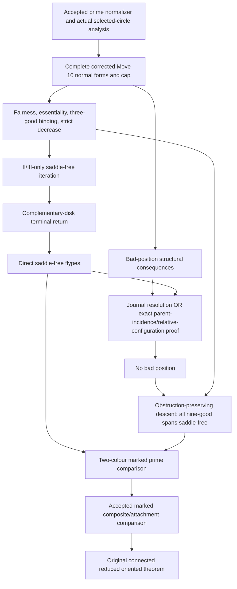

# Original105: literature-supported route and decision plan

2026-10-21. Literature planning only, following the user's pause on new proof-detail authoring. The original connected, reduced, oriented, composite-inclusive flyping statement is unchanged. This report gives a noncircular task graph; it does not certify a complete proof or restart a review round. Accepted proofs remain frozen, and native gates remain held.

## Conclusion and version control

The shortest route still uses the corrected Kindred hierarchy, but the available public v3 has a specific unbound hypothesis in its bad-position argument. Before further cap machinery is authored, compare that passage with the actual 2025 journal text or obtain the complete Menasco–Thistlethwaite proof. The existing local gaps must not be filled on the assumption that this source issue has disappeared.

The lead read the complete actual v3 §§4–5, PDF/printed pp. 27–33, for this plan, in addition to the previously read setup and selected technical passages. The coordinated reports below record their own complete primary-reading extents. The live arXiv record was fetched again: latest revision 29 August 2024, v3, 51 pages; its author comments explicitly say v2 Theorem 4.9 was false. Thus the general v2 cap-classification route stays discarded.

A later publication exists: *Advances in Mathematics* **482** (December 2025), 110642, DOI [10.1016/j.aim.2025.110642](https://doi.org/10.1016/j.aim.2025.110642). The team obtained bibliographic metadata, not its full text. Neither identity with v3 nor a correction of v3's application below has been verified. The available virtual companion, arXiv:2210.03720v2, pp. 17–20, imports the classical argument and specifically its proof of 3.22; it is not an independent repair.

The full Menasco–Thistlethwaite article is *The classification of alternating links*, Annals **138** (1993), pp. 113–171, DOI [10.2307/2946636](https://doi.org/10.2307/2946636). Its full text has not yet been obtained. A 1991 announcement, metadata, or access-restricted issue record cannot substitute for reading that proof. Its dedicated branch completed a bounded public-access search without retrieving the primary; its report is `../flyping-mt1993-literature/acquisition-and-plan-limits.json`. No MT proof architecture is invented here.

## What the corrected source actually requires

| Operation | Actual source | Minimal mathematical content | Current binding |
| --- | --- | --- | --- |
| Prepare an essential positive span relative to the fixed negative checkerboard | §§3, 7; selected-circle conclusions 4.1, p. 27 | Fair position, standard proper W-arcs, no early disk regions or black/white guides; actual markings and fixed common axes | Accepted normalizer and its focused repairs; do not reread suppliers |
| Choose and classify the local prisms | pp. 28–29; proof 4.2, p. 48 | Selected upper disk is a graph; OTHER upper disks are vertical boundary curtains in P; lower disks are projected disks; complete marked Figure 27 normal forms | II/III local work available at its stated scope; full Type-I normal form/body remains unearned |
| Construct the cap | p. 29, Figure 27, notes 54–56 | Actual old disk U and new disk V; literal equality of their F-boundaries; peripheral meridians/inessential circles; protected Z_i unchanged | These are necessary geometric claims, not supplied by a generic filling tool |
| Preserve fair/three-good position and decrease complexity | 4.3–4.4, p. 30; 4.8, p. 31; proofs p. 49 | Actual proper W-map and positive ports, appropriate crossing pieces, lower pieces disks, essentiality binding, strict decrease | Accepted local/compression and axis-ledger work is reusable only after actual cap inputs are bound |
| Prove the saddle-free case directly | 4.10, p. 31; terminal part of 4.9, p. 50 | Use only II/III caps, leave a chosen circle last, identify the exterior lower return, then one-prism and literal-flype conclusions | Complementary-disk mechanism located in source; marked terminal trace still needs exposition |
| Exclude bad position | 5.1–5.3, p. 32; 3.22 proof p. 45 | A suitable parent is C-free, and its exact flyping hypothesis or a sufficient replacement must be earned | Public-v3 application is not yet justified at the required scope |
| Deduce the prime theorem | 5.4–5.5, pp. 32–33 | Obstruction-preserving choice of cap plus finite descent; compare B' to B,W and then W' to B',W | Assembly after previous nodes, with actual component labels carried |
| Restore composites | Actual finite prime decompositions and marked comparison | Prime sequences induce the prescribed actual factor component maps; attachment congruence then lifts them | Accepted component-marked helper at this explicit prime-input scope |

The input is prime/nontrivial/nonsplit only for the prime stage. The original theorem concerns connected diagrams, so the supplied connected-alternating/nonsplit and finite diagrammatic decomposition interfaces lead to the accepted composite comparison. A crossingless unit is handled separately. No split-diagram theorem or loss of orientation/component markings is introduced.

## The Type-I task, at the source's actual scope

V3 p. 28 fixes the selected graph and makes every other upper disk a boundary curtain: X'∩Y1 is empty and X'∩P lies over its boundary. It does not merely allow arbitrary upper graph patches. V2 p. 33 explicitly had a full-white-fibre clause; v3 replaces that paragraph with the truncated-prism/curtain placement. Our earned full-fibre condition can remain useful, but it must not be misquoted as v3's literal premise.

Footnote 54 describes an auxiliary disk Xi parallel through an outer ball Zi containing the overpass, with the additional saddle disks in Zi; note 56 keeps Zi unchanged. Xi is not the selected F disk. The published normal-form assertion must therefore be expanded as a whole: the selected sheet, curtains, auxiliary separation, and actual peripheral and wall incidences together. A numerical O-to-U phase guess is not that assertion.

The next cap task, if this route is selected, is ONE source-faithful marked Type-I model: prove the left-hand Figure 27 normal form under the allowed positioning; identify its Fi disk and actual shadow boundary; construct the right-hand disk in that same physical model; check the meridian system, W-section, and Zi preservation; then glue. Work in the actual local handlebody if needed. The source does not require its entire root component to be a ball or a separately chosen white cut disk to divide that component into balls.

Observation 8.4, p. 48, gives one inner-wall arc per relevant lower piece. Proposition 8.5, p. 49, additionally gives one outer-wall arc for each lower disk abutting the selected common-face arcs. That second conclusion is stronger than the earlier working interface that allowed arbitrary repeated outer contacts. However it follows from Lemma 4.2 in the published proof: it cannot be used circularly to prove the same normal form. Reproduce the actual template first, or prove the narrower contact statement independently. No actual occurrence may simply be deleted.

The source fixes the F-boundary of its selected U and the protected Zi pieces. It does not assign every wall occurrence of every prism component to a single new Vi. Thus arbitrary-window completion, an arbitrary beta-to-axis bridge, a prescribed global height floor, and a mandatory embedded ambient root ball are unnecessary stronger helper demands. Our accepted free-central allocation is optional machinery once matching local disks exist; it is not an existence theorem for those disks.

## The terminal return has a source-indicated resolution

For the direct saddle-free branch, 4.8(B) preserves nine-good position and the other upper circles. Termination allows a chosen circle to be last. At that time BOTH complementary disks of S+ cut along the sole circle are innermost.

PDF p. 50 invokes Observation 8.1 to put Figure 27's yi,zi on the same global lower disk. Immediately before that line the actual TeX explicitly comments that both complementary disks are innermost. The intended resolution is to apply the innermost-return analysis to the EXTERIOR disk too. It is not a requirement to reconstruct all exterior state walks while retaining the original inner root and its graph domains.

The remaining exposition is small and specific: bind that complementary Observation 8.1/8.2 return to the actual marked yi,zi occurrences. The accepted FIRST global lower-disk distinctness then forces one prism. The one-prism Type-II exclusion uses primeness; the surviving Type III is the registered flype. Generic 4.9(A), Type-I triangle/rectangle classification, and its rank-one cell lemma are unnecessary for this restricted argument. The second outer-contact conclusion is not an extra premise of this terminal contradiction.

## The bad-position issue cannot be hidden in the DAG

The printed p. 32 proof of 5.3 establishes that the parent gamma1 is C-free and traverses the indicated overpass, then invokes 3.22. The literal 3.22 statement, p. 25, requires a FLYPING circle. Its p. 45 proof explicitly uses that hypothesis to bound by two the relevant global lower circles. The preceding bad-position argument does not explicitly establish it.

The actual TeX contains a COMMENTED alternative: cap the child, normalize, assert the parent is fixed, apply the saddle-free theorem, and transfer its flyping configuration back. This documents the intended relative route but is not a published proof of the assertion. In particular preserving parent white arcs alone does not control a Move 5 touching its black endpoint. Generic post-cap arcs cannot be treated as old lower paths.

There are two sufficient authoring alternatives if the final journal text does not resolve the scope:

1. Derive the exact lower-incidence bound used in p. 45 directly for this BAD-POSITION parent, and apply the actual local push argument. Do not silently assert it for every C-free parent.
2. Prove enough relative cleanup to preserve or transport the parent's ORIGINAL PROJECTED FLYPING CONFIGURATION and specified overpass, then use the independently proved saddle-free result. Pointwise fixation of every parent collar is stronger than necessary; an abstract surviving component label is weaker than necessary.

Root should select one of these after the version/alternate-source comparison. The relative route still owes its first-touch/propagation certificate; the direct route still owes its global lower-incidence bound. Neither is currently a logical supplier. No further lineage, bank, or classification helpers are authorized by this planning report.

## Noncircular dependency graph and next decision

The arrow from S to P is needed only for the relative-configuration alternative. No arrow from the final no-saddles theorem back into its own saddle-free prerequisite is allowed.

The next useful work is version/source comparison, not another local proof. Obtain and compare the 2025 final §§3–5/7–8, especially 3.22 and 5.3, if a new legitimate access path is available. The bounded MT acquisition has also ended without full text; do not repeat failed URLs or build an alternate proof plan from an announcement. If no corrected text is accessible, the complete Kindred authoring queue is exactly: the source-faithful Type-I model, the complementary marked terminal return, and ONE explicit bad-position bridge above. Existing accepted suppliers and local II/III mathematics are reused unchanged. A wholesale MT switch is justified only after its actual full proof and dependency workload are read and mapped.

## Accepted scopes retained without rereview

The normalizer is bound by `root-original-normalizer-final-review.json` and its recorded N1/N2/N3/N4 history. The FIRST distinct-global-lower-disk assertion is bound by `root-renewed-v3-shared-lower-disks-acceptance.json`; no outer-contact acceptance is inferred. Root accepted the actual Type-III body at its joint-positioned input, and `renewed-bridge/root-central-allocation-acceptance.json` covers the free-central ownership/gluing construction given local disks. The canonical `lem-component-marked-prime-decomposition-comparisons-lift-prime-flype-sequences` retains its explicit marked-prime-sequence input. None of these scopes supplies the missing Type-I model or the bad-position bridge.

## Coordinated evidence

* `renewed-typeI-incidence/literature-reconciliation.md`: actual full cap/preparation passages, version differences, circularity warning for outer contact, and source-level task.
* `renewed-bridge/literature-terminal-route-plan.md`: complete terminal source passage and the TeX complementary-disk clarification.
* `renewed-last-move10/literature-bad-position-resolution-plan.md`: literal p. 32/p. 45 scope, commented alternative, and two sufficient bridge choices.
* `renewed-typeI-literature/source-route-report.md`: journal/MT access limits and actual virtual-companion delegation.

No proof completion, original disposition, canonical edit, native gate, recertification, commit, or publication follows from this plan.
