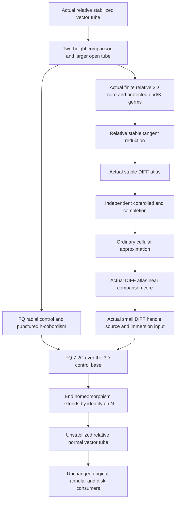

# Complete literature route to the original TOP applications

Planning document, 21 October 2026. Proof-detail authoring remains paused. This document supplies a coherent published route and identifies its remaining local proof obligations; it does not convert published theorems into locally proved suppliers. Accepted providers stay frozen. The latest root decision, recorded in `../../literature-first-execution-plan.md`, retains the DIFF implementation. The PL implementation below is an alternative, not a second concurrent reconstruction. Neither implementation currently closes the original TOP claims.

## The result needed, and the result already supplied

The completed stable-normal interface is an actual rank-two VECTOR normal neighborhood of the stabilized locally flat surface N×R in M⁴×R, where N=T² for the doubled annulus or N=S² for the doubled disk. It is relative to the actual prescribed normal germ on K×R, admits a wider disk domain, and has proper radius restrictions. Its embedding f fixes zero-section times, but does not preserve the ambient time away from zero. Projecting f(E×{0}) to M is therefore not an unstabilized normal-neighborhood construction.

The remaining geometric target is the corresponding actual normal VECTOR neighborhood in M⁴, preserving the K germ. That is precisely the desuspension in Freedman–Quinn 9.3A, printed137–141 (PDF143–147). Once supplied, its actual collar and side markings must be bound to the original annular connected-sum/group and disk/Seifert/metabolizer/Levine constructions. No original Statement asks for an arbitrary global normal framing or preservation of an independently prescribed auxiliary bottom DIFF atlas.

The stable interface has root adoption in `root-six-module-adoption.json`, with actual E, normal-refurl and S6 inputs bound at their distinct adopted scopes. `original-target-interface-binding.md` records the five original IDs and unchanged choice assumptions. Those accepted proofs were not reread for this plan.

## The main chain, in its necessary order

The diagram is a dependency order, not a list of accepted arrows. In particular the initial category structure must be earned before 7.2C; using 7.2C to create that structure would be circular.

**1. Keep the two height coordinates distinct.** FQ138 defines W using ambient a≥0 and abstract tube b≤1. FQ140 constructs its end deformations by composing pushes in the two coordinates; FQ140–141 then shrinks/reparametrizes radius to obtain the required fine punctured control. These maps do not assert W is a disk bundle, an arbitrary product, or a pair deformation retract of a prescribed finite complex. They are the published source of the controlled h-cobordism data.

Our accepted larger-tube localization (`root-comparison-tube-localization-acceptance.json`) provides the additional actual localization needed for tangent realization: a boundaryless open M0=f(int DρE×(−ε,1+ε)), compact finite core C=N×I, nested protected end/K sectors, and actual core contraction/relative transport. Uniform closeness of a and b near the compact zero strip places ambient a=0 inside the protected bottom sector and abstract b=1 inside the top sector. It supplies no false W-product conclusion. Realize a structure on M0 and restrict to W only afterwards.

**2. Supply the genuine finite relative reduction.** On the finite three-dimensional pair (C,A), A consists of both end sectors and the K sectors. The input is the actual stable TOP tangent bundle and actual prescribed reductions on open neighborhoods of A. The desired output is one compatible finite-rank reduction with its actual tangent identification; an abstract vector-bundle isomorphism or equality of w1,w2 is insufficient. No prescribed orthonormal frame is needed.

The efficient published foundation is FQ8.3B, printed119 (PDF125): TOP/PL≃K(Z/2,3) and PL/DIFF is six-connected. The fiber sequence gives π_i(TOP/DIFF)=0 for i≤2. Relative obstruction theory over (C,A) therefore has no obstruction to existence. The actual localization/transport contract then transfers this reduction to M0 with the protected germs. This remains a named missing local foundation, including finite stabilization and its ACω specialization; it is not supplied by the accepted stable tube.

The exact published classification/realization sources are Kirby–Siebenmann IV10.1, printed194/PDF202; sections/lifts IV10.6, printed196/PDF204; the open-relative version IV10.11, printed199/PDF207; and TOP/PL IV10.12, printed202/PDF210. Their dimension-five boundary qualification is real: the whole boundary must already be prescribed. Applying the theorem to boundaryless M0 makes this qualification vacuous while retaining the actual open end germs. Alternatively a direct W application must prescribe its full boundary.

FQ139 itself extends a TOP-END smoothing toward the core; it does not promise agreement with an original ambient bottom smoothing. Thus the original TOP conclusion does not force our two-end DIFF comparison problem. Nevertheless retaining both available end reductions is a consistent implementation, provided the standard relative reduction theorem is actually supplied. In the surface case the abstract top E⁴ already has a smooth structure: FQ8.2's separate open-four-manifold smoothing theorem is unnecessary here.

**3. Realize the stable structure and desuspend it independently.** The adopted relative integration and finite-desuspension interfaces are DIFF-only. They may be used after their actual reduction and geometric inputs are bound; they do not compute TOP/DIFF connectivity. Quinn's six-page 2006 paper, §3.1, gives the independent order: actual stabilized CAT manifold over a literal product end → controlled end completion → cellular boundary map → ordinary cellular approximation → CAT atlas on the base. Iterate only the finitely many R factors introduced by the actual finite stabilization. No theorem about parameter families is needed for atlas existence.

The independent end theorem is Quinn, Ends of maps I, relative Theorem2.1, printed282. Its source is already DIFF/PL, dimension≥6; its input includes the actual relative completion, tame onto 0-LC end, locally constant local fundamental groups and the stated Wh(π×Z^r) vanishing. The literal product supplies the end hypotheses. The literal absolute statement1.4, printed280, omits the word tame; use the precise relative2.1 or retain tameness explicitly. Definitions2.2/2.5, printed282–283, produce buffered approximate completions. The summable schedule and assembly are2.8, printed284–285. Whole-end strong deformation packages are sufficient extra implementations, not additional hypotheses of this published theorem.

Quinn6.1, printed309, omits classical subdivision/small-isotopy details for small handles and collars. That precise finite primitive, rather than an unrestricted globally sorted handle theorem, must be supplied wherever a local reconstruction needs it. Frontier paths/disks are constructed before kernel removal in7.2, printed314–317; higher connectivity and the kernel stage are7.3–7.4, printed317–320. Their actual post-operation witnesses and full forward/inverse set-control must be bound. Existing conditional local contracts do not supply absent instances automatically.

**4. Apply the final five-dimensional product theorem at its actual scope.** FQ7.2C, printed110–111/PDF116–117, requires the stated simplicial/NDR control setup, good local groups, an immersion lemma in the source category, and an actual sufficiently small category-handlebody satisfying the relative no-handle condition. It does not manufacture those inputs. In9.3A the control base is N²×(0,1), dimension3, and link groups are 0 or Z; the relevant obstruction is zero. An arbitrary five-dimensional control-base matrix theory is unnecessary for this final application. Actual smoothing/desuspension may still use independent higher-dimensional machinery.

The resulting arbitrarily small end homeomorphism extends by identity across N, as FQ139 states, yielding the unstabilized vector neighborhood with the required radial extension. The extension, relative K buffers, orientation and actual annular/disk collars require the original-facing assembly review; they are not consequences of merely bounding |a−b|.

## The independent cellular-approximation branch

This branch proves the realization input above if the complete published product-structure theorem is reconstructed locally. It is not another prerequisite imposed on a product-structure theorem already proved locally by some other route.

Siebenmann, Topology11 (1972), printed271–294, Theorem A at271, is ordinary proper cellular approximation in TOP dimension≥5. Its dimension-five boundary restriction must be a homeomorphism. Our literal M0-based targets are boundaryless. Only ordinary nonparametric approximation in finitely many dimensions5,…,4+k is required. Relative germs can be retained by approximation off a closed protected buffer with error tending to zero at that buffer; that localization must itself be bound, not inferred from a parametric theorem we did not prove.

The complete published local chain is MainLemma2.2 at275, punctured-torus construction277–280, E1 Lemma2.5 at279/AppendixI288–289, positive-handle E2 AppendixII289–292, specific E3 expanders at282, boundary isotopy2.6 at283, then finite-color/index globalization283–284. E1 needs ordinary sphere-times-line homotopy type plus 1-LC at infinity; a general proper-homotopy-product recognition theorem is stronger. E2 needs existence of a suitable composite finite cover, not all sufficiently large covers. E3 fixes the specified saturated core and constructs the specified expanders, not arbitrary protected-compact expansion from a weak homotopy equivalence.

The special E1 published cap chain is available through Lacher1967, printed299–304, boundary-point Corollary2.4 and halfstring Theorem2.3; Calcut–King–Siebenmann2012 Theorem7.3, printed1835, supplies the proper TOP hyperplane result using its actual proper-ray inputs; Chernavsky2006 supplies the local union step. The mapping-cylinder truncation in CSI3.4, printed1817–1818, is closed and relatively compact. Single-hyperplane homeomorphism does not need the stronger stable-homeomorphism/annulus or ambient-isotopy conclusions. An accepted compact arc chart does not replace the proper-ray input. This avoids the unavailable joint Cantrell–Lacher article as a necessary source, and avoids a four-dimensional Whitney argument.

Source category is the potential circularity to exclude: Siebenmann's general TOP-source PL-extension imports cannot be justified by the product-structure theorem currently being proved. In the Quinn application the source already inherits DIFF, allowing that source specialization if all actual core/complement bindings are supplied. The exact finite smooth engulfing reconstruction has one first-review finding about adapted subdivisions preserving actual collapse order; it remains held, not accepted. No further repair is authorized during this planning pause.

## The PL alternative and its cost

A shorter infinitesimal existence calculation uses the actual bottom/top/K PL germs and TOP/PL≃K(Z/2,3): H⁴(C,A;Z/2)=0 since the relative core is three-dimensional. H³ need not vanish; uniqueness is unnecessary. Published KS IV10.1 then realizes the actual relative PL structure on boundaryless M0, and FQ7.2C permits the PL category when its actual immersion/handle inputs are supplied.

This avoids PL/DIFF and the relative O-reduction calculation. It requires NEW PL-formulated transport, realization/desuspension and actual small-handle bindings. The accepted DIFF integration, smooth source-index filtration and smooth finite-desuspension consumers cannot be renamed PL. Rourke–Sanderson Proposition6.9, printed82–83, supplies the published second-derived star products/derived collars once an actual fine PL triangulation is present. Consequently PL is a legitimate alternative with a category-binding cost, not a route already locally completed. Root presently chooses DIFF reuse.

Neither lane eliminates the surgery underlying the standard TOP/PL classification theorem. If its local proof is demanded, the complete KS classification module must be deliberately selected. The existing specialized six/seven-dimensional S/F contracts do not supply KS's periodic fourteen/fifteen-dimensional surgery/fibering arguments. Reconstructing arbitrary frame families or launching all of surgery in parallel would exceed the actual finite-core interface.

## Choice, sources and the bounded execution order

Published theorem proofs under ordinary foundations do not certify ACω automatically. Disk/Seifert/metabolizer/Levine items allow full AC. Annular compatibility and the group theorem retain Countable Choice. The accepted stable tube has that strength. The chosen reduction, integration, end completion, ordinary CE and final relative desuspension must each expose a finite/countable construction on these compact/σ-compact inputs before the annular branch can close. Finite obstruction cells, finitely many stabilization stages and preselected countable tolerance/cover packets are the intended scope; an unexamined dependent sequence of witnesses is not a choice audit.

The next work, after the route-validation questions are settled, has four seams in order: (i) the standard relative low-connectivity/finite-rank reduction and its choice contract; (ii) actual integration/end-completion/ordinary-CE instances, using the published independent order and only needed finite primitives; (iii) the exact FQ9.3A controlled source, product, extension and relative collar binding; (iv) the unchanged original consumers. Their bounded reviews retain existing first-pass histories. No new helper count substitutes for an original closure.

Full primary reading by this lead: FQ9.3A137–141; FQ8.1–8.3 printed114–120; relevant bibliography253–255; previously the complete fifteen-page KS codimension-two normal argument. The four coordinated reports below record their authors' actual full-text extents and pinpoint the remaining sources. Their reports were read as planning evidence, not as rechecks of accepted proofs:

- `../renewed-relative-tangent-germ/literature-route-plan.md`: KS exact relative classification and the low-connectivity/surgery chain.
- `../renewed-relative-smoothing/literature-supported-completion-plan.md`: Quinn2006 all six pages and exact DIFF-only interface bindings.
- `../renewed-controlled-h-cobordism/quinn-published-route-literature-audit.md`: Quinn I end-completion and final FQ7.2C distinction.
- `../renewed-cellular-approximation/literature-route-plan.md` and `annular-e1-complete-literature-plan.md`: full Siebenmann1972 and the actual cap/hyperplane primary chain.

FQ's original reference Quinn, Ends of maps III: Dimensions4and5, JDG17(1982),503–521, DOI10.4310/jdg/1214437139, was identified bibliographically but not acquired here. An attempted retrieval produced a different1972 announcement; both cached files are explicitly named `quinn-1972-surgery-announcement-retrieved-instead.*`. No reading or theorem proof credit is assigned to the unavailable Ends III. FQ's complete9.3A exposition is the primary normal-bundle proof read for this plan.

The exact original IDs remain `lem-knot-concordance-compatible-with-connected-sum`, `thm-knot-concordance-is-an-abelian-group`, `lem-locally-flat-slice-surface-bounds-seifert-hypersurface`, `lem-slice-disk-induces-seifert-metabolizer`, and `thm-levine-algebraic-concordance-surjection-proof`. The first two retain ACω; the last three retain full AC. A normal-neighborhood theorem alone does not establish their entire Statements. The full original TOP route remains open until the named foundations, actual instances and final consumer bindings are supplied.
